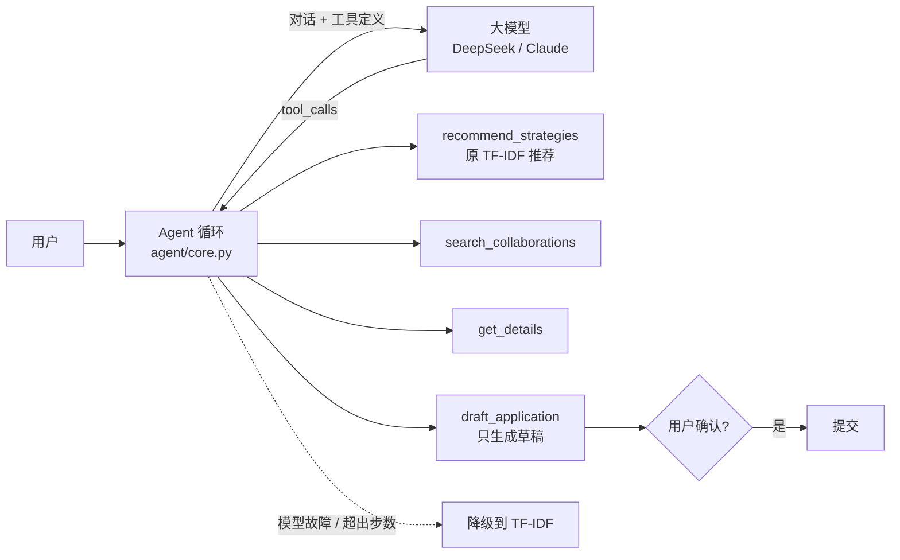

# ContentFlow Agent

ContentFlow 是我的硕士毕业项目，一个创作者推荐与协作平台，使用 TF-IDF 文本相似度推荐创作方向。本项目是它的 **AI Agent 升级版**：用户用自然语言（包括中文）描述自己，大模型自主决定调用哪些工具，推荐创作方向、匹配合作需求，并起草合作申请。

## 为什么要升级

原来的 TF-IDF 推荐有三个局限：

| 局限 | 例子 | Agent 的做法 |
|---|---|---|
| 只能精确匹配词语 | 用户输入「旅行 摄影」，英文数据里一个结果也匹配不到 | 模型先理解用户需求，再把它转写成英文关键词去调用工具 |
| 需要填写结构化表单 | 用户必须分别填写兴趣、技能、目标 | 用户直接聊天；信息不够时，模型会追问 |
| 推荐和合作是两个独立功能 | 用户要自己在两个页面之间来回操作 | 模型把推荐方向、找合作、起草申请串成一个流程 |

## 架构



## 设计要点

- **Agent 循环自己实现**：用的是 LangChain 的 `bind_tools`，但没有直接调用现成的 Agent 执行器，而是自己写了一个“模型 → 工具 → 模型”的循环，每一步都看得见、可控制。
- **复用原有算法**：原来的 TF-IDF 推荐被封装成工具 `recommend_strategies`，维度和权重与原项目一致（兴趣 0.35、技能 0.30、目标 0.20、条件 0.15）。新旧方案是结合关系，不是替代关系。
- **可解释**：工具会返回匹配到的关键词和分数。系统提示词要求模型只推荐工具返回的结果，并说明推荐理由，避免模型凭空编造。
- **稳定性**：
  - 设置最大步数，防止死循环；
  - 工具报错时，把错误信息返回给模型，让它自己修正；
  - 模型调用失败时，自动降级到 TF-IDF 推荐。
- **人在回路**：`draft_application` 只生成申请草稿，由用户确认后才会提交。
- **模型可切换**：在 `.env` 里改一行 `LLM_PROVIDER`，就能在 DeepSeek 和 Claude 之间切换，方便做对比评估。

## 运行

```bash
python3 -m venv .venv
.venv/bin/pip install -r requirements.txt
cp .env.example .env        # 然后在 .env 里填写自己的 API Key
.venv/bin/python cli.py     # 或者用 cli.py claude 指定模型
```

测试不需要 API Key：用一个按剧本回复的假模型，验证工具调用、错误处理、降级和草稿确认这几个流程。

```bash
.venv/bin/python -m pytest -q
```

## 评估

测试集共 30 条中文用例（[eval/cases.json](eval/cases.json)），分为 5 类：表达清晰、口语化、带约束条件（不露脸、只有手机等）、中英混杂或跨领域、信息不足。每条用例都人工标注了 1–2 个“推荐了就算对”的方向。在同一批用例上对比三种方案：

- **A**：原 TF-IDF 直接处理用户原话
- **B**：大模型只把需求转写成英文关键词，排序仍由 TF-IDF 完成
- **C**：完整 Agent，转写之后由模型结合用户需求自行挑选

DeepSeek 上的结果（26 条计分用例 + 4 条信息不足用例）：

| 方案 | Hit@1 | Hit@2 |
|---|---|---|
| A. TF-IDF（原始文本） | 4% | 4% |
| B. TF-IDF + 大模型转写关键词 | 65% | 85% |
| C. 完整 Agent | **88%** | **88%** |

- 信息不足的 4 条用例，Agent 全部先追问，没有直接给推荐。
- 平均每次耗时 5.0 秒，消耗约 4800 个输入 token 和 380 个输出 token。

**从结果中得到的结论**

1. **最大的提升来自“理解”**：A 只命中了 1 条，就是那条中英混杂的用例，因为英文词恰好对上。B 说明，仅仅让模型把需求转写成关键词，就能解决中文和口语化表达的问题。
2. **模型的判断也有价值**：有 6 条用例，C 修正了 B 的第一名。主要是带约束条件的用例，比如用户“不想露脸”“预算很少”，TF-IDF 不理解这些约束，模型会据此调整排序。
3. **剩下的错误集中在检索层**：c14（自律日常）和 c18（对谈节目）在 B 这一步就没有召回正确方向，因为模型写出的关键词和数据里的用词对不上，Agent 无法推荐它看不到的结果。值得一提的是，在这两条用例上，模型都明确告诉用户“匹配度不高，不硬推”，没有编造结果。这说明下一步应该把关键词检索换成**向量检索**，而不是继续调提示词。
4. c16 中，模型在信息已经足够的情况下仍然先追问了一句（短视频还是长视频），按评估规则记为未命中。

**局限**：样本量小（30 条），只运行了一次，标注带有主观判断，所以这些数字只能说明大致趋势。之后要优化提示词或检索时，应该另外准备一批新用例来验证，避免只针对这 30 条去调整。

运行评估：`.venv/bin/python -m eval.run_eval --provider deepseek`，详细结果保存在 `eval/results/`。

## 数据

`data/demo_data.json` 是从原 ContentFlow 项目的数据迁移和演示数据中只读导出的，包括 12 个内容方向、7 个合作需求和 4 位创作者。原项目没有做任何修改。

## 下一步计划

- [x] 评估体系：30 条测试用例，对比 TF-IDF、大模型转写、完整 Agent 三种方案
- [ ] 向量检索：用 PostgreSQL + pgvector 实现语义检索，解决评估中发现的召回不足问题，并用一批新用例验证
- [ ] 在同一测试集上对比 DeepSeek 与 Claude
- [ ] Web 页面：接入 Django，支持流式输出
